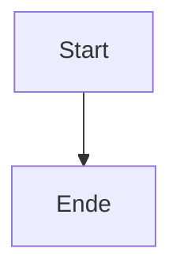

Markdown Cheat Sheet

Ein persönliches Nachschlagewerk für alle Markdown-Elemente, die im Laufe des Semesters verwendet werden.

Inhaltsverzeichnis
1. Text
2. Lists
3. Links and images
4. Code
5. Quotes
6. Tables
7. Layout
8. GitHub Extras
Pitfalls
1. Text
Headings

CommonMark · Überschriften werden mit ein bis sechs Rauten erstellt.

# Überschrift 1
## Überschrift 2

Paragraphs and line breaks

CommonMark · Absätze werden durch Leerzeilen getrennt. Ein erzwungener Zeilenumbruch benötigt zwei Leerzeichen oder einen Backslash am Ende.

Erster Absatz.

Zweiter Absatz mit Zeilenumbruch.\
Neue Zeile im selben Absatz.

Italic, bold and both

CommonMark · Text wird durch Sternchen kursiv, fett oder beides formatiert.

*kursiv*, **fett**, ***fett und kursiv***

Strikethrough

GitHub · Doppelte Tilden auf jeder Seite durchstreichen Text.

~~durchgestrichener Text~~

Inline code

CommonMark · Einzelne Backticks heben Code im Fließtext hervor.

Nutze den Befehl `git status`.

Escaping a character

CommonMark · Ein Backslash verhindert die Markdown-Interpretation von Sonderzeichen.

\*Dieser Text wird trotz Sternchen nicht kursiv dargestellt.\*

2. Lists
Unordered, ordered and nested lists

CommonMark · Ungeordnete Listen nutzen - oder *, nummerierte Listen Ziffern. Verschachtelungen erfolgen durch Einrückung.

- Punkt 1
  - Unterpunkt 1.1
1. Erster Schritt
2. Zweiter Schritt

Task lists

GitHub · Interaktive Checkboxen für Aufgaben.

- [x] Erledigte Aufgabe
- [ ] Offene Aufgabe

3. Links and images
Inline and reference-style links

CommonMark · Verlinkungen direkt im Text.

[TH Köln](https://www.th-koeln.de)

A relative link to another file

GitHub · Verlinkung auf andere Dateien im eigenen Repository.

[Zur Lizenz](../../LICENSE)

A link to a section

GitHub · Sprungmarke zu einer Überschrift im selben Dokument.

[Zum Inhaltsverzeichnis](#inhaltsverzeichnis)

An image with alt text and image link

CommonMark · Einbinden von Bildern mit Alternativtext.


4. Code
Fenced code blocks with syntax highlighting

CommonMark · Mehrzeilige Codeblöcke mit Syntax-Highlighting für Python, Bash und JSON.

```python
print("Hello, World!")
```

5. Quotes
Blockquotes

CommonMark · Zitate werden mit > eingeleitet und lassen sich verschachteln.

> Ein Zitat
> > Verschachteltes Zitat

Alerts

GitHub · Spezielle Hinweisboxen für GitHub-Markdown.

> [!NOTE]
> Dies ist ein wichtiger Hinweis.

6. Tables
Table with aligned columns and a cell containing a pipe

CommonMark · Tabellen mit ausgerichteten Spalten (:---, :---:, ---:). Ein \| innerhalb einer Zelle muss maskiert werden.

| Links | Zentrum | Rechts |
| :--- | :---: | ---: |
| A | B | C |
| Code `a \| b` | normal | formatiert |

7. Layout
Horizontal rules

CommonMark · Trennlinien durch drei Bindestriche.

---

Collapsed sections

GitHub · Einklappbare Abschnitte über HTML-Tags.

HTML
<details>
<summary>Klicken zum Ausklappen</summary>
Versteckter Inhalt.
</details>

Comments

CommonMark · HTML-Kommentare, die beim Rendern unsichtbar bleiben.

HTML
<!-- Dieser Text ist unsichtbar -->

8. GitHub Extras
Footnotes

GitHub · Fußnoten am Dokumentenende.

Text mit Fußnote[^1].

[^1]: Erklärung der Fußnote.

Emoji shortcodes

GitHub · Emojis über Kürzel einfügen.

:rocket: :tada:

@mentions and references to issues

GitHub · Erwähnung von Personen oder Issues.

@breuert #1

A Mermaid diagram

GitHub · Erstellung von Diagrammen via Text.



A formula

GitHub · Mathematische Formeln in LaTeX-Syntax.

$E = mc^2$

Pitfalls
Zeilenumbrüche: Normaler Textumbruch im Editor erzeugt auf GitHub keinen neuen Absatz. Lösung: Eine echte Leerzeile lassen oder einen Backslash \ am Zeilenende nutzen.
Tabellen-Syntax: Wenn in einer Tabellenzelle ein Pipe-Zeichen (|) verwendet wird, zerreißt das die Tabelle, sofern es nicht als \| escaped wird.
Codeblöcke in Codeblöcken: Um in einem Markdown-Dokument dreifache Backticks in einem Codeblock darzustellen (wie in diesem Cheat Sheet), muss der äußere Block mit vier Backticks umschlossen werden.
